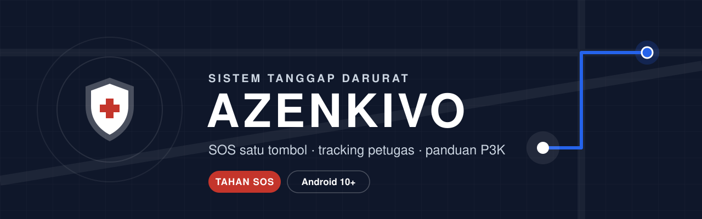
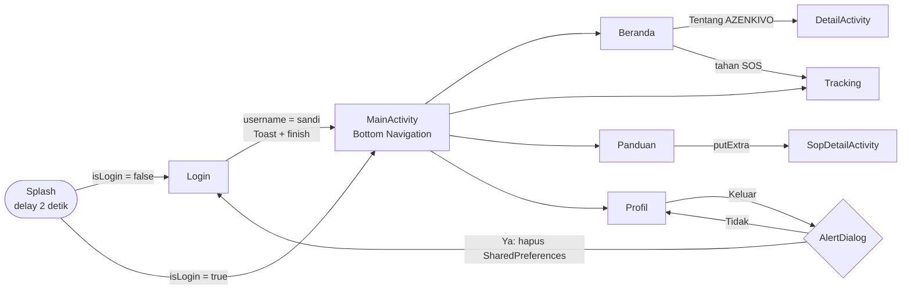
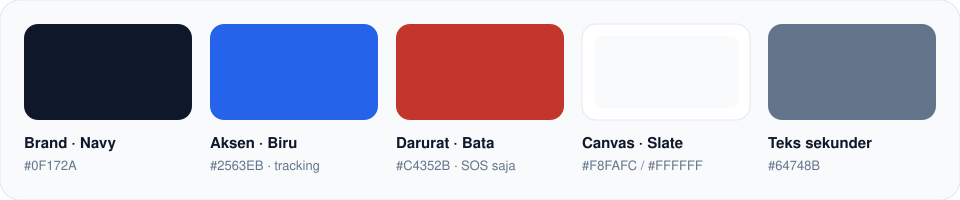

<div align="center">



<br>


**Aplikasi Android untuk meminta bantuan darurat, memantau petugas yang datang, dan membaca panduan P3K.**

Tugas mata kuliah **Pemrograman Mobile (TI432228)** · Politeknik Caltex Riau

[Fitur](#-fitur) · [Alur](#-alur-aplikasi) · [Pemenuhan tugas](#-pemenuhan-tugas--modul) · [Design system](#-design-system-guardian-shield) · [Menjalankan](#-cara-menjalankan)

</div>

---

> [!NOTE]
> Data petugas, peta, dan notifikasi adalah **simulasi lokal**. Aplikasi ini belum memakai backend.

## ✦ Fitur

<table>
<tr>
<td width="50%" valign="top">

### 🛡️ Beranda
- Sapaan **Halo, *username*** dari SharedPreferences
- Kartu status kondisi sekitar → **Info BMKG** (WebView)
- **Tombol SOS tahan 2 detik**: progress mengisi, getar, lalu konfirmasi. Lepas sebelum penuh = batal
- Panggilan cepat **112 · 119 · 113 · 115** (`ACTION_DIAL`)
- Kartu **Tentang AZENKIVO** → DetailActivity

</td>
<td width="50%" valign="top">

### 📍 Tracking
- Peta simulasi dengan rute petugas terdekat
- Ringkasan waktu tiba, jarak, dan status **SOS aktif**
- Daftar petugas: **ListView + Custom Adapter + Glide**
- Tombol **Hubungi** di setiap kartu, **Hubungi Ambulans**, dan **Batal SOS**

</td>
</tr>
<tr>
<td valign="top">

### 📖 Panduan
- 8 SOP P3K & bencana: CPR, pendarahan, luka bakar, tersedak, patah tulang, gempa, kebakaran, banjir
- **ListView + SimpleAdapter**
- Detail SOP dikirim lewat `putExtra`, ditampilkan sebagai **timeline langkah** + tombol panggil nomor yang sesuai

</td>
<td valign="top">

### 👤 Profil
- Identitas medis: golongan darah, kontak keluarga, catatan medis
- Switch notifikasi siaga & **izin lokasi GPS** (mengikuti izin sistem)
- Tombol **Keluar** → AlertDialog logout

</td>
</tr>
</table>

**Menu toolbar:** 🔦 senter · ✉️ kirim pesan darurat (WhatsApp/SMS) · 📞 telepon kontak keluarga

**Login:** CardView, TextInputLayout, validasi kolom kosong, Toast hasil input, mode **Tamu** untuk keadaan darurat.

## ✦ Alur aplikasi



## ✦ Pemenuhan tugas & modul

| Syarat | Penerapan | File |
|---|---|---|
| ViewBinding | Semua Activity & Fragment | `build.gradle.kts` (`viewBinding = true`) |
| Login kreasi sendiri + Toast | Toast menampilkan username yang diketik | `LoginActivity.kt` |
| CardView di Login | Form di dalam `androidx.cardview.widget.CardView` | `activity_login.xml` |
| Intent Login → MainActivity | `startActivity(...)` lalu `finish()` | `LoginActivity.kt` |
| Intent MainActivity → Detail | Kartu Tentang AZENKIVO di Beranda | `HomeFragment.kt` |
| DetailActivity + gambar | Banner proyek, deskripsi, fitur, teknologi | `DetailActivity.kt`, `activity_detail.xml` |
| AlertDialog Logout | Ya → Login · Tidak → tetap di halaman | `MainActivity.kt` (`showLogoutDialog`) |
| **P5** Toolbar, Option Menu, WebView | Toolbar tiap tab, menu aksi darurat, Info BMKG | `MainActivity.kt`, `WebViewActivity.kt` |
| **P6** SharedPreferences | `user_pref` → `isLogin`, `username` | `LoginActivity.kt`, `SplashActivity.kt` |
| **P6** Splash Screen | `lifecycleScope` + `delay(2000)` + cek login | `SplashActivity.kt` |
| **P7** Fragment + Bottom Navigation | `replaceFragment()` tanpa back stack | `MainActivity.kt`, `bottom_nav_menu.xml` |
| **P7** ListView SimpleAdapter | 8 data SOP | `PanduanFragment.kt` |
| **P7** Custom Adapter + Glide | Model, `getView()`, klik di adapter | `Tracking/ResponderAdapter.kt` |

> [!TIP]
> Di Modul P7, Bottom Navigation ada di `BaseActivity`. Di proyek ini perannya dipegang **MainActivity**, supaya alur tugas *Login → MainActivity* tetap terpenuhi.

## ✦ Design system: Guardian Shield



| Prinsip | Keterangan |
|---|---|
| **Merah hanya untuk darurat** | Merah bata `#C4352B` dipakai di SOS, panggilan darurat, dan status SOS aktif saja |
| **Navy untuk aksi utama** | Tombol, avatar, bulatan langkah, dan logo |
| **Biru untuk petugas** | Tracking, ETA, dan tombol Hubungi |
| **Tipografi** | Plus Jakarta Sans (400–700) dengan skala `Azenkivo.Type.*` |
| **Aksesibilitas** | Target sentuh ≥ 48 dp, grid 8 dp, label TalkBack di tombol penting |

## ✦ Struktur proyek

```
app/src/main/java/com/example/azenkivo/
├── SplashActivity.kt        # Splash + cek isLogin
├── LoginActivity.kt         # CardView, validasi, Toast, SharedPreferences
├── MainActivity.kt          # Bottom Navigation, toolbar, AlertDialog logout
├── DetailActivity.kt        # Detail proyek
├── SopDetailActivity.kt     # Detail SOP (timeline langkah)
├── WebViewActivity.kt       # Info BMKG
├── Home/HomeFragment.kt
├── Tracking/                # TrackingFragment, ResponderModel, ResponderAdapter
├── Panduan/PanduanFragment.kt
├── Profile/ProfileFragment.kt
└── ui/custom/ThinkingOrbView.kt   # Loading bola titik di splash

app/src/main/res/
├── layout/      # activity_*, fragment_*, item_*
├── values/      # colors, themes, styles (Guardian Shield)
├── drawable/    # ikon vector, ilustrasi, latar
└── font/        # Plus Jakarta Sans
```

## ✦ Tech stack

| Komponen | Versi |
|---|---|
| Bahasa | Kotlin |
| SDK | min 29 (Android 10) · target 37 |
| Build | Gradle Kotlin DSL + version catalog, AGP 9.3.2 |
| UI | XML + ViewBinding, Material Components 1.14.0 (Material 3), ConstraintLayout 2.2.2, CardView 1.0.0 |
| Lifecycle | lifecycle-runtime-ktx 2.9.4 |
| Gambar | Glide 4.16.0 |

**Izin:** `INTERNET` (Glide & WebView), `ACCESS_FINE_LOCATION` / `ACCESS_COARSE_LOCATION` (dikelola dari Profil).

## ✦ Cara menjalankan

```bash
git clone https://github.com/refflabs/AZENKIVO.git
```

1. Buka folder proyek di Android Studio, lalu **Sync Now**.
2. Jalankan di emulator atau HP Android 10 ke atas. Internet dibutuhkan untuk foto petugas dan Info BMKG.
3. **Login demo:** isi username dan sandi dengan teks yang sama, misalnya `tim1` / `tim1`. Atau pilih **Masuk sebagai Tamu**.

## ✦ Rencana pengembangan

- [ ] Simpan riwayat SOS ke **Room**
- [ ] Peta live tracking dengan **Maps SDK**
- [ ] Data gempa terkini dari BMKG dengan **Retrofit**
- [ ] Notifikasi peringatan darurat

---

<div align="center">

Dibuat oleh **Reffael Evindonta Pardede** · 3 TI · Politeknik Caltex Riau

</div>
